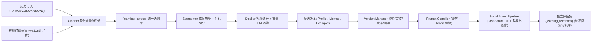

# QFlareBot Social V0.12.0 — 总体架构设计

## 1. 设计原则

- **双引擎解耦**：实时群聊引擎（`src/chat/pipeline.ts`）与离线/增量学习引擎（`src/learning/*`）完全解耦；实时聊天仅读取已发布且可缓存的风格档案与按需 D1 轻量样本，学习失败绝不阻塞或影响正常群聊。
- **单管道共享**：离线历史导入与在线消息采集统一汇聚至 `{learning_corpus}`，共享同一套清洗、脱敏、去重、质量评分、成员均衡采样、场景切分、风格蒸馏与版本管理流水线。
- **零外部依赖、零 DO**：全部模块基于 TypeScript + D1 + QFlareBot `ctx.service('llm')` + SDK v5 `cron`。

## 2. 模块划分（`src/learning/`）

| 序号 | 模块文件 | 职责 |
| --- | --- | --- |
| 1 | `src/learning/types.ts` | 学习子系统全部结构化类型、严格 Schema 校验与默认值 |
| 2 | `src/learning/cleaner.ts` | Corpus Cleaner & Quality Evaluator：格式规范化、编码处理、敏感信息脱敏、注入拦截、机器人消息排除、客观质量评分、内容哈希与匿名化发送者 ID |
| 3 | `src/learning/importer.ts` | Corpus Importer：TXT / CSV / JSON / JSONL 与自定义字段映射解析、分块入库、跨来源去重、授权校验 |
| 4 | `src/learning/segmenter.ts` | Dialogue Segmenter & Member Balancer：成员采样均衡（单成员 ≤ 20%，小群自适应）、按时间间隔/引用/`@`/话题切分对话窗口并保留来源 `corpus_id` |
| 5 | `src/learning/distiller.ts` | Style Distiller / Behavior Learner / Meme Extractor / Example Extractor：程序客观统计 + 分批 LLM 语义提取 + 严格 Schema 校验 + 长期/近期双层融合与候选版本生成 |
| 6 | `src/learning/retrieval.ts` | Retrieval Engine：D1 轻量按需检索（CJK 2-gram + 话题/行为/情绪标签 + 时间衰减 + 质量加权 + 去重多样化），附带向量检索扩展接口（默认关闭） |
| 7 | `src/learning/prompt-compiler.ts` | Dynamic Prompt Compiler：按 9 级优先级编译风格提示词，严格控制风格(800) / 热梗(400) / 示例(800) / 总计(2000) Token 预算，带版本感知内存缓存与重复表达检测 |
| 8 | `src/learning/scheduler.ts` | Learning Scheduler & Version Manager：租约并发锁、检查点断点续跑、幂等执行、定时扫描、候选版本审核/发布/冻结/回滚、隐私删除联动失效 |
| 9 | `src/learning/feedback.ts` | Feedback Evaluator & Style Lab：显式反馈记录、隐式承接辅助统计、A/B/C/D/E 五模式同上下文风格实验室对比（不发群、不污染上下文与语料） |
| 10 | `src/store/learning-db.ts` | D1 数据访问层（严格 `{table}` 占位符与 `group_id` 隔离） |

## 3. 数据流与调用链

## 4. 与多模态、语音及自适应路由联动

- **三通道共享**：`pipeline.ts` 在进入 Fast / Smart / Full 前仅编译一次风格上下文并复用于整次请求及单跳自主升级，不在 ReAct 循环每步重复检索。
- **工具表达一致**：工具调用结果回填后仍处于同一份群聊风格系统提示词下，避免退化为客服腔。
- **语音风格联动**：风格档案中的语气倾向（轻松调侃/温柔安慰/自然口语等）作为语音情绪提示参考，绝不修改已配置音色或克隆真人声音。
- **Phase 6 向量检索预留**：`retrieval.ts` 预留 `VectorRetriever` 接口，当前 `style_vector_enabled` 默认 `false`；待平台支持 Vectorize 绑定或授权外部向量服务后可无缝接入混合检索，不可用时自动降级 D1。
